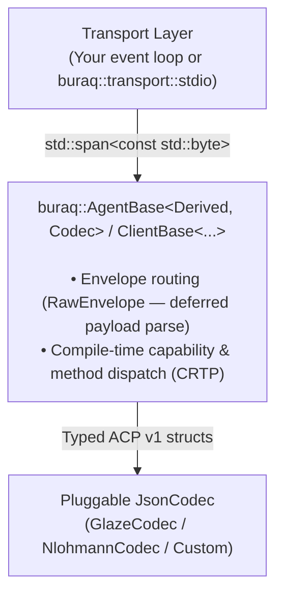

# buraq

[](https://github.com/<owner>/buraq/actions/workflows/ci.yml)

**Zero-overhead, sans-I/O C++20/23 implementation of the [Agent Client Protocol (ACP)](https://agentclientprotocol.com).**

`buraq` bridges native C++ applications (IDEs, game engines, terminals, custom editors) and local or remote AI coding agents over JSON-RPC 2.0—without vtables, heap-allocated callback maps, or event-loop lock-in.

---

## Why `buraq`?

The Agent Client Protocol standardizes communication between **Clients** (editors/hosts) and **Agents** (autonomous coding assistants), much like LSP did for language servers. While official SDKs target Rust, TypeScript, Python, and JVM languages, native C++ codebases—editors, CAD/engineering suites, game engines, and `llama.cpp`-based local inference agents—need a protocol layer that respects systems-level constraints:

* **Sans-I/O Architecture:** Feed raw byte frames (`std::span<const std::byte>`) from any transport (`stdio` pipes, Asio, `libuv`, `io_uring`, Qt event loops, or WebSockets) and emit serialized responses through a generic sink callable.
* **Zero-Cost Static Polymorphism (CRTP):** `AgentBase<Derived, Codec>` and `ClientBase<Derived, Codec>` use C++20 `requires` expressions inside `if constexpr` to resolve supported ACP methods and optional capabilities at compile time. Unimplemented methods compile away completely.
* **Zero Core Dependencies & Pluggable Codecs:** The protocol state machine depends only on the C++ standard library. JSON serialization is abstracted behind the `buraq::JsonCodec` concept, with ready-to-use adapters included for **`glaze`** and **`nlohmann/json`**.
* **C++20 Baseline + C++23 Sugar:** Compiles cleanly on `-std=c++20` while automatically adopting native `std::expected` and `std::generator` via standard feature-test macros (`__cpp_lib_*`) when built with `-std=c++23`.

---

## Architecture Overview



---

## Quick Start: Building an ACP Agent

```cpp
#include <buraq/acp.hpp>
#include <buraq/codecs/glaze.hpp>
#include <buraq/transport/stdio.hpp>

class EchoAgent : public buraq::AgentBase<EchoAgent, buraq::GlazeCodec> {
public:
    buraq::expected<buraq::v1::InitializeResult, buraq::RpcError>
    on_initialize(const buraq::v1::InitializeParams&) {
        return buraq::v1::InitializeResult{
            .agentInfo = buraq::v1::ImplementationInfo{"buraq-echo", "0.1.0"}
        };
    }

    buraq::expected<buraq::v1::SessionNewResult, buraq::RpcError>
    on_session_new(const buraq::v1::SessionNewParams&) {
        return buraq::v1::SessionNewResult{.sessionId = "sess_1"};
    }

    template <typename Sink>
    buraq::expected<buraq::v1::SessionPromptResult, buraq::RpcError>
    on_session_prompt(const buraq::v1::SessionPromptParams& params, Sink& sink) {
        emit_session_update(buraq::v1::SessionUpdateNotification{
            .sessionId = params.sessionId,
            .update = buraq::v1::AgentMessageChunk{
                .content = buraq::v1::TextContent{.text = "Echo from buraq!"}
            }
        }, sink);

        return buraq::v1::SessionPromptResult{.stopReason = "end_turn"};
    }
};

int main() {
    EchoAgent agent;
    return buraq::transport::run_stdio_agent(agent);
}
```

---

## Building & Running

### Requirements
* A C++20-capable compiler (GCC 12+, Clang 16+, MSVC 19.34+); GCC 14+ / Clang 18+ recommended for C++23 features.
* CMake 3.23+
* Optional JSON backend: [Glaze](https://github.com/stephenberry/glaze) or [nlohmann/json](https://github.com/nlohmann/json) (fetched automatically for examples/tests when `BURAQ_FETCH_CODECS=ON`).

```bash
cmake -B build -DCMAKE_CXX_STANDARD=23
cmake --build build
```

### Smoke-Testing Over `stdio`

```bash
printf '%s\n' \
  '{"jsonrpc":"2.0","id":1,"method":"initialize","params":{"protocolVersion":1,"clientCapabilities":{}}}' \
  '{"jsonrpc":"2.0","id":2,"method":"session/new","params":{"cwd":"/tmp","mcpServers":[]}}' \
  '{"jsonrpc":"2.0","id":3,"method":"session/prompt","params":{"sessionId":"sess_1","prompt":[{"type":"text","text":"ping"}]}}' \
  | ./build/buraq_echo_agent
```

---

## Roadmap

- [x] Sans-I/O JSON-RPC 2.0 envelope framing & deferred payload decoding
- [x] CRTP `AgentBase` and `ClientBase` static method routing
- [x] Pluggable `JsonCodec` concept with `GlazeCodec` and `NlohmannCodec` adapters
- [x] Newline-delimited `stdio` transport loop & working echo agent
- [ ] Full ACP v1 schema coverage (`session/load`, `session/request_permission`, `terminal/*`, `plan`, and multimodal `ContentBlock` variants)
- [ ] Codec parity & round-trip test suite (`ctest`)
- [ ] Opt-in C++23 `std::generator` streaming prompt interface (`BURAQ_HAS_STD_GENERATOR`)
- [ ] Verification against the official `@agentclientprotocol/acp-tck` test compatibility kit
- [ ] Packaging support for `vcpkg` and `Conan`

---

## License

Licensed under the [Apache License, Version 2.0](LICENSE) (or [MIT License](LICENSE-MIT), at your option).
