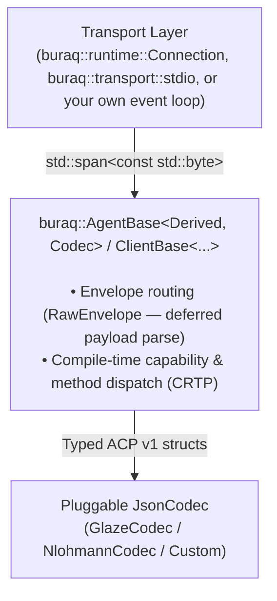

# buraq

[](https://github.com/khubaibumer/buraq/actions/workflows/ci.yml)
[](https://github.com/khubaibumer/buraq/actions/workflows/ci.yml)
[](https://khubaibumer.github.io/buraq/)
[](LICENSE)
[](#requirements)

**Zero-overhead, sans-I/O C++20/23 implementation of the [Agent Client Protocol (ACP)](https://agentclientprotocol.com).**

`buraq` bridges native C++ applications (IDEs, game engines, terminals, custom editors) and local or remote AI coding agents over JSON-RPC 2.0—without vtables, heap-allocated callback maps, or event-loop lock-in.

📖 **API reference:** <https://khubaibumer.github.io/buraq/>

---

## Why `buraq`?

The Agent Client Protocol standardizes communication between **Clients** (editors/hosts) and **Agents** (autonomous coding assistants), much like LSP did for language servers. While official SDKs target Rust, TypeScript, Python, and JVM languages, native C++ codebases—editors, CAD/engineering suites, game engines, and `llama.cpp`-based local inference agents—need a protocol layer that respects systems-level constraints:

* **Batteries included, but optional:** `buraq::runtime` gives you a ready-made threaded connection—`serve_stdio(agent)` for agents, `spawn_agent(client, {"my-agent"})` for clients (POSIX and Windows)—with `std::future`-returning calls, so a working client or agent is a few dozen lines. Drop down to the sans-I/O core whenever you need your own event loop.
* **Sans-I/O Architecture:** Feed raw byte frames (`std::span<const std::byte>`) from any transport (`stdio` pipes, Asio, `libuv`, `io_uring`, Qt event loops, or WebSockets) and emit serialized responses through a generic sink callable.
* **Zero-Cost Static Polymorphism (CRTP):** `AgentBase<Derived, Codec>` and `ClientBase<Derived, Codec>` use C++20 `requires` expressions inside `if constexpr` to resolve supported ACP methods and optional capabilities at compile time. Unimplemented methods compile away completely.
* **Zero Core Dependencies & Pluggable Codecs:** The protocol state machine depends only on the C++ standard library. JSON serialization is abstracted behind the `buraq::JsonCodec` concept, with ready-to-use adapters included for **`glaze`** and **`nlohmann/json`**.
* **C++20 Baseline + C++23 Sugar:** Compiles cleanly on `-std=c++20` while automatically adopting native `std::expected` and `std::generator` via standard feature-test macros (`__cpp_lib_*`) when built with `-std=c++23`.

---

## Architecture Overview



---

## Installation

`buraq` is header-only. The core (`buraq/acp.hpp`) depends only on the C++ standard library; pick a codec header (`buraq/codecs/glaze.hpp` or `buraq/codecs/nlohmann.hpp`) and link the matching JSON library yourself.

### CMake `FetchContent`

```cmake
include(FetchContent)
FetchContent_Declare(
    buraq
    GIT_REPOSITORY https://github.com/khubaibumer/buraq.git
    GIT_TAG        v0.1.0
    GIT_SHALLOW    TRUE
)
FetchContent_MakeAvailable(buraq)   # examples/tests/install rules are off when not top-level

target_link_libraries(my_agent PRIVATE buraq::buraq glaze::glaze)  # or nlohmann_json::nlohmann_json
```

### Installed package (`find_package`)

```bash
cmake -B build -DBURAQ_BUILD_EXAMPLES=OFF -DBURAQ_BUILD_TESTS=OFF
cmake --install build --prefix /opt/buraq
```

```cmake
find_package(buraq CONFIG REQUIRED)
target_link_libraries(my_agent PRIVATE buraq::buraq)
```

### vcpkg

The port lives in [`ports/buraq`](ports/buraq) until it is accepted into the vcpkg registry. It is pinned to the `v0.1.0` release archive, so use it as an overlay port. The `glaze` and `nlohmann-json` features pull in the matching JSON library:

```bash
git clone https://github.com/khubaibumer/buraq.git   # main carries the pinned port
vcpkg install "buraq[glaze]" --overlay-ports=buraq/ports
```

To build unreleased changes from a checkout instead, generate an overlay that points at the local sources: `python3 buraq/scripts/vcpkg_port.py overlay vcpkg-overlay`, then pass `--overlay-ports=vcpkg-overlay`.

```cmake
find_package(buraq CONFIG REQUIRED)
find_package(glaze CONFIG REQUIRED)
target_link_libraries(my_agent PRIVATE buraq::buraq glaze::glaze)
```

### Conan 2

The recipe is [`conanfile.py`](conanfile.py). Options `with_glaze` and `with_nlohmann_json` add the codec dependency:

```bash
git clone --branch v0.1.0 https://github.com/khubaibumer/buraq.git
conan create buraq -s compiler.cppstd=23 -o "buraq/*:with_glaze=True"
```

```ini
# conanfile.txt
[requires]
buraq/0.1.0
[options]
buraq/*:with_glaze=True
[generators]
CMakeDeps
CMakeToolchain
```

Both packages export the same `buraq::buraq` target as `find_package`. [`test_package/`](test_package) is the consumer smoke test CI runs against each one.

### Single header (drop-in)

Copy `single_include/buraq/acp.hpp` (core + stdio transport, zero dependencies) and, if wanted, `single_include/buraq/codecs/<codec>.hpp` and `single_include/buraq/runtime/connection.hpp` (threaded runtime; link with threads) into your tree. Each release also attaches `acp.hpp` as an asset. The files are generated by `python3 scripts/amalgamate.py`; CI fails if they drift from `include/`.

---

## Quick Start: Building an ACP Agent

```cpp
#include <buraq/acp.hpp>
#include <buraq/codecs/glaze.hpp>
#include <buraq/runtime/connection.hpp>

class EchoAgent : public buraq::AgentBase<EchoAgent, buraq::GlazeCodec> {
public:
    buraq::expected<buraq::v1::InitializeResult, buraq::RpcError>
    on_initialize(const buraq::v1::InitializeParams&) {
        return buraq::v1::InitializeResult{
            .agentInfo = buraq::v1::ImplementationInfo{"buraq-echo", "0.1.0"}
        };
    }

    buraq::expected<buraq::v1::SessionNewResult, buraq::RpcError>
    on_session_new(const buraq::v1::SessionNewParams&) {
        return buraq::v1::SessionNewResult{.sessionId = "sess_1"};
    }

    template <typename Sink>
    buraq::expected<buraq::v1::SessionPromptResult, buraq::RpcError>
    on_session_prompt(const buraq::v1::SessionPromptParams& params, Sink& sink) {
        emit_session_update(buraq::v1::SessionUpdateNotification{
            .sessionId = params.sessionId,
            .update = buraq::v1::AgentMessageChunk{
                .content = buraq::v1::TextContent{.text = "Echo from buraq!"}
            }
        }, sink);

        // Only delegate fs/* and terminal/* calls the client advertised during `initialize`.
        // Under buraq::runtime the hook runs off the I/O thread, so it can simply wait for the reply.
        if (client_can_read_text_file()) {
            auto file = request_fs_read({.sessionId = params.sessionId, .path = "/workspace/README.md"},
                                        sink, buraq::use_future).get();
            if (!file) return buraq::unexpected(file.error());
        }

        return buraq::v1::SessionPromptResult{.stopReason = "end_turn"};
    }

    void on_session_cancel(const buraq::v1::SessionCancelParams&) { /* stop the running turn */ }
};

int main() {
    EchoAgent agent;
    return buraq::runtime::serve_stdio(agent);  // reads stdin, writes stdout, returns on EOF
}
```

`serve_stdio` reads on one thread and runs request hooks on another, so hooks may block on `use_future` replies while `session/cancel` is still delivered. If you want zero threads, `buraq::transport::run_stdio_agent(agent)` is the single-threaded loop (then use the callback form of the requests instead of `use_future`).

Handlers are discovered at compile time; omit any you don't support and `buraq` answers with JSON-RPC `-32601 Method not found`. With C++23 you may instead implement `std::generator<v1::SessionUpdatePayload> on_session_prompt_stream(const v1::SessionPromptParams&)` and `co_yield` updates.

After a successful `initialize`, `AgentBase` exposes the negotiated client state: `initialized()`, `client_capabilities()`, `client_info()`, `client_can_read_text_file()`, `client_can_write_text_file()`, `client_supports_terminal()`, `client_supports_terminal_auth()`, `client_supports_elicitation_form()` / `_url()`, and `client_supports_boolean_config_options()`.

## Quick Start: Building an ACP Client

`spawn_agent` launches the agent process, wires its stdio to your client and returns a running connection whose methods return `std::future`s:

```cpp
#include <buraq/acp.hpp>
#include <buraq/codecs/nlohmann.hpp>
#include <buraq/runtime/connection.hpp>

class MyClient : public buraq::ClientBase<MyClient, buraq::NlohmannCodec> {
public:
    void on_session_update(const buraq::v1::SessionUpdateNotification& n) {
        if (auto* chunk = std::get_if<buraq::v1::AgentMessageChunk>(&n.update)) { /* render */ }
    }

    buraq::expected<buraq::v1::RequestPermissionResult, buraq::RpcError>
    on_request_permission(const buraq::v1::RequestPermissionParams& p) {
        return buraq::v1::RequestPermissionResult{
            .outcome = buraq::v1::PermissionSelectedOutcome{.optionId = p.options.front().optionId}};
    }

    buraq::expected<buraq::v1::FsReadTextFileResult, buraq::RpcError>
    on_fs_read_text_file(const buraq::v1::FsReadTextFileParams& p) {
        return buraq::v1::FsReadTextFileResult{.content = load_file(p.path)};
    }
};

int main() {
    MyClient client;
    auto conn = buraq::runtime::spawn_agent(client, {"my-agent", "--acp"});   // or a SpawnOptions{env, cwd}
    if (!conn) return std::cerr << conn.error() << '\n', 1;
    auto& agent = **conn;

    auto init = agent.initialize({.clientCapabilities = {.fs = buraq::v1::FileSystemCapabilities{.readTextFile = true}}}).get();
    auto session = agent.new_session({.cwd = "/workspace"}).get();
    auto turn = agent.prompt({.sessionId = session->sessionId,
                              .prompt = {buraq::v1::TextContent{.text = "Fix the build"}}}).get();
    std::cout << "stop reason: " << turn->stopReason << '\n';   // every update was delivered before this
}   // closes the agent's stdin and reaps the process
```

See [`examples/minimal_client.cpp`](examples/minimal_client.cpp) for the complete program.

### Bring your own event loop (sans-I/O)

`ClientBase` / `AgentBase` never do I/O themselves: you own the transport, `buraq` owns framing, id correlation and dispatch. Every `send_*` takes an outbound sink and a completion token (a callback or `buraq::use_future`):

```cpp
MyClient client;
auto to_agent = [&](std::span<const std::byte> bytes) { /* write bytes + '\n' to the agent's stdin */ };

client.send_initialize({}, to_agent,
    [](buraq::expected<buraq::v1::InitializeResult, buraq::RpcError> res) { /* ... */ });

// For every NDJSON line read from the agent's stdout:
client.feed(std::as_bytes(std::span{line.data(), line.size()}), to_agent);
```

`buraq::runtime::Connection<Peer>` is that loop packaged: wrap any `LineChannel` (pipes, sockets, an in-memory queue) and call `start()`.

### Deferred replies, futures and cancellation

* **Deferred replies:** any request hook may take a `buraq::Responder<Result>` by value and return `void` instead of returning the result. Keep the responder (it is a cheap copyable handle), and call `respond()`, `fail()` or `reply()` later from any thread—e.g. after a UI permission click or a model stream finishes. `responder.sink()` is a thread-safe sink for `emit_session_update` and nested requests. Dropping the last copy without replying sends `-32603`, so the peer never waits forever.
* **Typed outbound requests:** `request_permission`, `request_fs_read`, `request_terminal_*`, `request_elicitation` (agents) and all `send_*` (clients) accept a callback or `buraq::use_future`; `send_request<Result>(method, params, sink, token)` covers methods not modelled yet. `pending_count()` and `cancel_all_pending(err)` manage outstanding requests (e.g. on disconnect).
* **Exceptions:** an exception escaping a request hook is answered with `-32603` instead of tearing down the connection.

---

## ACP v1 Method Coverage

`buraq` models the complete **stable** ACP v1 schema (`schema/v1/schema.json`). Methods marked *unstable* are kept for compatibility with hosts that still send them.

`buraq::runtime::Connection` adds future-returning shorthands for each row (`initialize`, `new_session`, `prompt`, `cancel`, … on clients; `session_update`, `request_permission`, `read_text_file`, `create_terminal`, … on agents) plus `request<Result>(method, params)` / `notify(method, params)`.

| Method | Direction | `buraq` API | Status |
|---|---|---|---|
| `initialize` | Client → Agent | `on_initialize` / `send_initialize` | ✅ |
| `authenticate` | Client → Agent | `on_authenticate` / `send_authenticate` | ✅ |
| `logout` | Client → Agent | `on_logout` / `send_logout` | ✅ |
| `session/new` | Client → Agent | `on_session_new` / `send_session_new` | ✅ |
| `session/load` | Client → Agent | `on_session_load` / `send_session_load` | ✅ |
| `session/resume` | Client → Agent | `on_session_resume` / `send_session_resume` | ✅ |
| `session/list` | Client → Agent | `on_session_list` / `send_session_list` | ✅ |
| `session/delete` | Client → Agent | `on_session_delete` / `send_session_delete` | ✅ |
| `session/close` | Client → Agent | `on_session_close` / `send_session_close` | ✅ |
| `session/set_mode` | Client → Agent | `on_session_set_mode` / `send_session_set_mode` | ✅ |
| `session/set_config_option` | Client → Agent | `on_session_set_config_option` / `send_session_set_config_option` | ✅ |
| `session/set_model` | Client → Agent | `on_session_set_model` / `send_session_set_model` | ✅ (unstable in ACP) |
| `session/prompt` | Client → Agent | `on_session_prompt` / `on_session_prompt_stream` (C++23) / `send_session_prompt` | ✅ |
| `session/cancel` | Client → Agent (notification) | `on_session_cancel` / `send_session_cancel` | ✅ |
| `session/update` | Agent → Client (notification) | `emit_session_update` / `on_session_update` | ✅ |
| `session/request_permission` | Agent → Client | `request_permission` / `on_request_permission` | ✅ |
| `fs/read_text_file` | Agent → Client | `request_fs_read` / `on_fs_read_text_file` | ✅ |
| `fs/write_text_file` | Agent → Client | `request_fs_write` / `on_fs_write_text_file` | ✅ |
| `terminal/create` | Agent → Client | `request_terminal_create` / `on_terminal_create` | ✅ |
| `terminal/output` | Agent → Client | `request_terminal_output` / `on_terminal_output` | ✅ |
| `terminal/wait_for_exit` | Agent → Client | `request_terminal_wait_for_exit` / `on_terminal_wait_for_exit` | ✅ |
| `terminal/kill` | Agent → Client | `request_terminal_kill` / `on_terminal_kill` | ✅ |
| `terminal/release` | Agent → Client | `request_terminal_release` / `on_terminal_release` | ✅ |
| `elicitation/create` | Agent → Client | `request_elicitation` / `on_elicitation_create` | ✅ |
| `elicitation/complete` | Agent → Client (notification) | `notify_elicitation_complete` / `on_elicitation_complete` | ✅ |
| `$/cancel_request` | Both (notification) | `send_cancel_request` / `on_cancel_request` | ✅ |
| `_`-prefixed extensions | Both | `send_ext_method`, `request_ext_method`, `send_ext_notification` / `on_ext_method`, `on_ext_notification` | ✅ |

`session/update` payloads (all 14 stable kinds): `user_message_chunk`, `agent_message_chunk`, `agent_thought_chunk`, `tool_call` (`v1::ToolCallUpdate`), `tool_call_update` (`v1::ToolCallStatusUpdate`), `plan`, `available_commands_update`, `current_mode_update`, `config_option_update`, `session_info_update`, `usage_update`, `notice`, `compaction_update`, `compaction_summary_chunk`.

Also modelled: every `ContentBlock` (with `annotations`), `McpServer` (`stdio` / `http` / `sse`), `AuthMethod` (agent / `terminal`), session config options (select with groups, boolean), `systemPrompt`, `additionalDirectories`, and the full `ClientCapabilities` / `AgentCapabilities` trees. Free-form JSON (`rawInput`, `rawOutput`, elicitation schemas and content, extension params) is carried verbatim as `buraq::RawJson`.

### Protocol guarantees

* **Initialize gating:** when the agent implements `on_initialize`, requests received before a successful `initialize` are rejected with `-32600`, and notifications are dropped.
* **Param validation:** after decoding, `v1::validate()` enforces schema MUSTs (absolute `cwd` and file paths, non-empty ids) and answers `-32602` with a reason. Both `AgentBase` and `ClientBase` apply it.
* **Errors:** `RpcError::auth_required()` (`-32000`) and `RpcError::session_not_found(id)` (`-32002`, with `data.sessionId`) cover the ACP-specific codes. `buraq::error_code` lists all of them.
* **Negotiated capabilities:** `AgentBase` keeps the client's `initialize` state. Use the `client_can_*` / `client_supports_*` helpers to gate `fs/*`, `terminal/*`, elicitation, and boolean config options. `ClientBase` keeps `agent_capabilities()`, `agent_info()`, and `auth_methods()` from a typed `send_initialize`.

### Forward compatibility

Both codecs ignore unknown JSON keys at every nesting level, including newer optional properties sent by hosts such as Zed or JetBrains IDEs. Absent or `null` optional fields keep their defaults.

* **`_meta`:** every schema struct carries `std::optional<buraq::RawJson> _meta`, round-tripped verbatim, so ACP extension metadata is never lost.
* **Unknown union tags:** every tagged union (`ContentBlock`, `SessionUpdatePayload`, `ToolCallContent`, `McpServer`, `AuthMethod`, `PermissionOutcome`) has a `v1::Unknown{tag, raw}` alternative. A newer `sessionUpdate` / content `type` decodes into it instead of failing the frame, and re-encodes byte-for-byte. Malformed payloads of a *known* kind still go to `on_unhandled_session_update` when a client defines it.

### Conformance

CI runs the echo agent against the official [ACP Conformance Test Kit](https://github.com/agentclientprotocol/acp-tck) (`acp-tck` v0.4.0). The verdict is **CONFORMANT**, with all MANDATORY requirements passing. The one remaining ADVISORY finding is `ACP-SESSION-004`: the echo example does not launch MCP servers, which is the application's job, not the SDK's. CI also exchanges messages with the official `@agentclientprotocol/sdk` TypeScript client.

---

## Building & Running

### Requirements
* A C++20-capable compiler (GCC 12+, Clang 16+, MSVC 19.34+); GCC 14+ / Clang 18+ recommended for C++23 features.
* CMake 3.23+
* Optional JSON backend: [Glaze](https://github.com/stephenberry/glaze) or [nlohmann/json](https://github.com/nlohmann/json) (fetched automatically for examples/tests when `BURAQ_FETCH_CODECS=ON`).
* Supported codec versions: Glaze 4.4.3+ (tested with 4.4.3 and 9.1.0; Glaze itself requires C++23) and nlohmann/json 3.11.3+. Glaze 5.0.0 exactly needs `-DBURAQ_GLAZE_LEGACY_DETAIL_NAMESPACE=0`, because its version cannot be detected from its headers.

```bash
cmake -B build -DCMAKE_CXX_STANDARD=23
cmake --build build
ctest --test-dir build --output-on-failure
```

| CMake option | Default | Purpose |
|---|---|---|
| `BURAQ_BUILD_EXAMPLES` | top-level only | Build `buraq_echo_agent` / `buraq_minimal_client` |
| `BURAQ_BUILD_TESTS` | top-level only | Build the codec-parity test suites (`include/` and `single_include/`) |
| `BURAQ_FETCH_CODECS` | `ON` | Fetch Glaze / nlohmann_json for examples and tests if not found |
| `BURAQ_INSTALL` | top-level only | Generate `install()` and `find_package(buraq)` export rules |
| `BURAQ_ENABLE_COVERAGE` | `OFF` | Instrument tests/examples (GCC/Clang) and add the `buraq_coverage` target |
| `BURAQ_COVERAGE_FAIL_UNDER_LINE` | `0` | Make `buraq_coverage` fail below this line-coverage percentage (CI uses `90`) |
| `BURAQ_BUILD_DOCS` | `OFF` | Add the `buraq_docs` target (Doxygen API reference) |
| `BURAQ_DOCS_WARN_AS_ERROR` | `OFF` | Make `buraq_docs` fail on any Doxygen warning, including undocumented entities (CI uses `ON`) |

### Code coverage

Requires GCC or Clang and [gcovr](https://gcovr.com) 8.3+ (`pip install gcovr`):

```bash
cmake -B build-cov -DCMAKE_BUILD_TYPE=Debug -DBURAQ_ENABLE_COVERAGE=ON
cmake --build build-cov --target buraq_coverage
```

The target resets the counters, runs `ctest`, and prints a per-header summary. It writes `build-cov/coverage/index.html` (annotated source), `coverage.xml` (Cobertura), `summary.json`, and `summary.md`. Only `include/buraq/` is measured. CI publishes the summary for each run and uploads the HTML report as an artifact. On pushes to `main` it also refreshes the README coverage badge, which reads `coverage.json` on the `badges` branch.

### API reference

The API reference is published at **<https://khubaibumer.github.io/buraq/>** and is generated from the inline `///` comments in `include/buraq/`. To build it locally you need [Doxygen](https://www.doxygen.nl) (Graphviz is optional and adds class graphs):

```bash
cmake -B build-docs -DBURAQ_BUILD_DOCS=ON -DBURAQ_BUILD_EXAMPLES=OFF -DBURAQ_BUILD_TESTS=OFF
cmake --build build-docs --target buraq_docs   # -> build-docs/docs/html/index.html
```

The `Docs` workflow builds the reference with warnings treated as errors, so every public entity must be documented. On pushes to `main` it deploys the reference to GitHub Pages.

### Smoke-Testing Over `stdio`

```bash
printf '%s\n' \
  '{"jsonrpc":"2.0","id":1,"method":"initialize","params":{"protocolVersion":1,"clientCapabilities":{}}}' \
  '{"jsonrpc":"2.0","id":2,"method":"session/new","params":{"cwd":"/tmp","mcpServers":[]}}' \
  '{"jsonrpc":"2.0","id":3,"method":"session/prompt","params":{"sessionId":"sess_1","prompt":[{"type":"text","text":"ping"}]}}' \
  | ./build/buraq_echo_agent
```

Wire compatibility with the official TypeScript SDK is checked in CI:

```bash
npm install --no-save @agentclientprotocol/sdk
node scripts/verify_sdk.mjs ./build/buraq_echo_agent
```

Run the official conformance kit locally (requires [`uv`](https://docs.astral.sh/uv/)):

```bash
uvx --from git+https://github.com/agentclientprotocol/acp-tck@v0.4.0 acp-tck -- "$PWD/build/buraq_echo_agent"
```

---

## Roadmap

- [x] Sans-I/O JSON-RPC 2.0 envelope framing & deferred payload decoding
- [x] CRTP `AgentBase` and `ClientBase` static method routing with typed request correlation
- [x] Pluggable `JsonCodec` concept with `GlazeCodec` and `NlohmannCodec` adapters
- [x] Newline-delimited `stdio` transport loop & working echo agent / minimal client
- [x] ACP v1 schema coverage (`session/load`, `session/request_permission`, `fs/*`, `terminal/*`, `plan`, multimodal `ContentBlock`)
- [x] Codec parity test suite (`ctest`) across GCC, Clang, AppleClang, and MSVC
- [x] Opt-in C++23 `std::generator` streaming prompt interface (`BURAQ_HAS_STD_GENERATOR`)
- [x] Wire verification against the official `@agentclientprotocol/sdk`
- [x] Single-header amalgamation (`single_include/`)
- [x] Full stable ACP v1 surface: auth, session lifecycle (`resume`/`list`/`delete`/`close`), config options, elicitation, `$/cancel_request`, extension methods
- [x] Official ACP conformance kit (`acp-tck`) in CI
- [x] Threaded runtime (`serve_stdio`, `spawn_agent`, future-returning `Connection`), deferred `Responder` replies, `_meta` and unknown-variant passthrough
- [ ] Unstable ACP features (subagents, NES, providers) behind an opt-in flag
- [x] Packaging support for `vcpkg` (overlay port) and `Conan` 2 (recipe + `test_package`)
- [ ] Submit the port / recipe to the vcpkg registry and ConanCenter

---

## Contributing & Security

See [CONTRIBUTING.md](CONTRIBUTING.md) for the development workflow and [SECURITY.md](SECURITY.md) for reporting vulnerabilities.

## License

Licensed under the [Apache License, Version 2.0](LICENSE).
